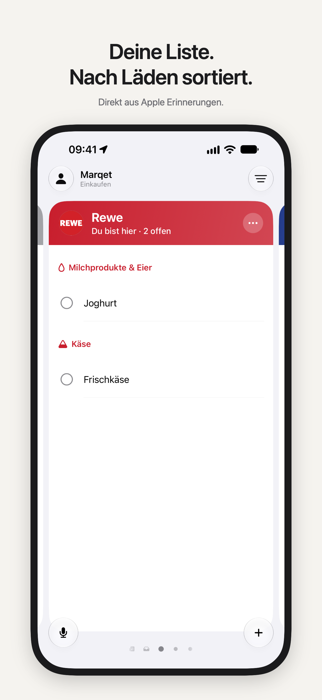
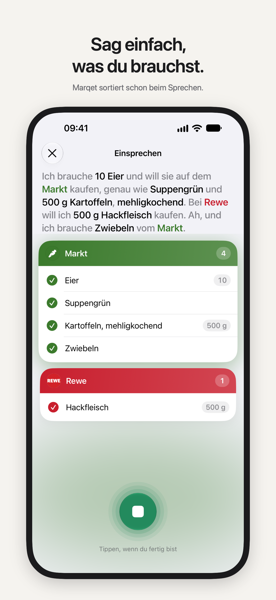
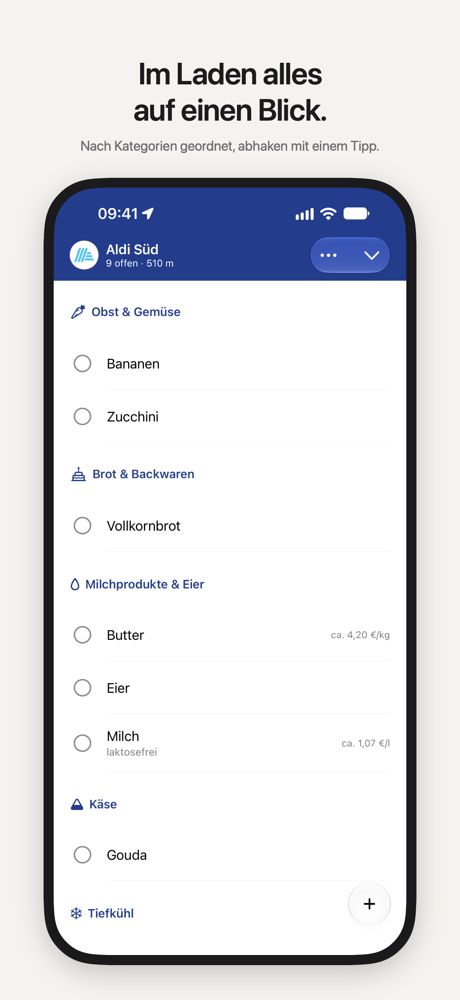
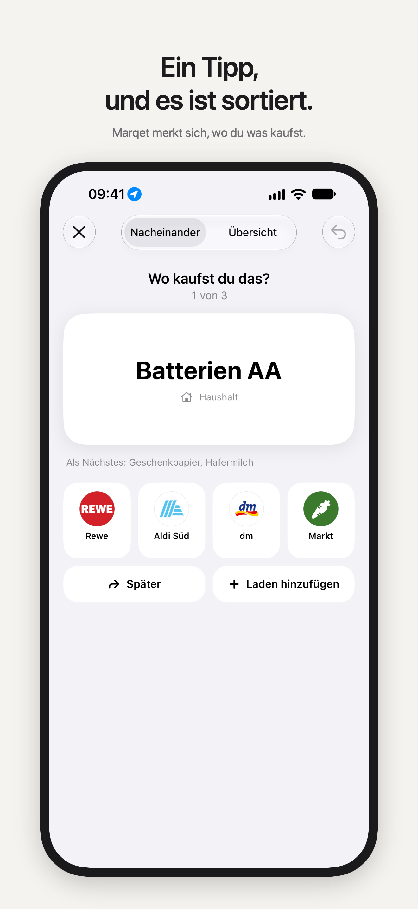
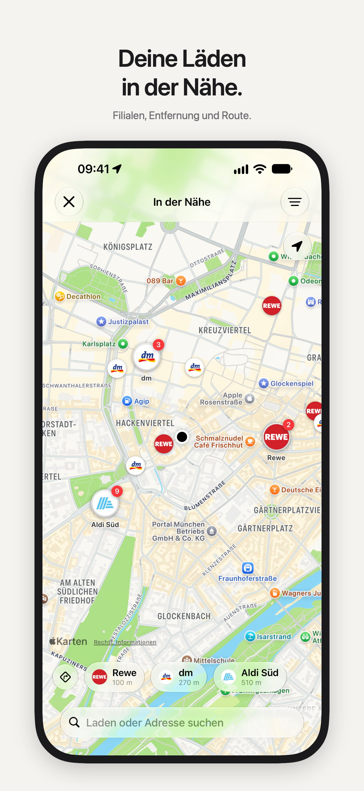
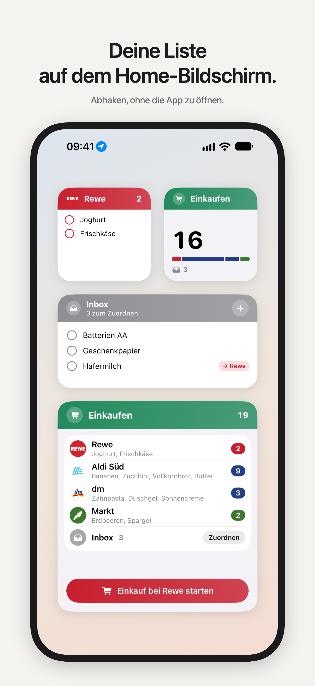

<div align="center">


# Marqet

**Deine Einkaufsliste aus Apple Erinnerungen, nach Läden sortiert.**

[](https://github.com/bnbln/marqet/actions/workflows/ci.yml)


[Konzept](docs/KONZEPT.md) · [Widgets & Live-Aktivität](docs/KONZEPT-WIDGETS.md) · [Markt & Angebote](docs/MARKTANALYSE.md) · [Entwicklung](#entwicklung)

</div>

<br>

<table>
  <tr>
    <td></td>
    <td></td>
    <td></td>
  </tr>
  <tr>
    <td></td>
    <td></td>
    <td></td>
  </tr>
</table>

## Worum geht’s

Einträge landen wie gewohnt in Apple Erinnerungen: per Siri, in der Erinnerungen-App oder über eine geteilte Familienliste. Marqet liest diese Liste, ordnet jeden Eintrag einem Laden zu und zeigt pro Laden eine große, wischbare Card in dessen Markenfarbe. Im Laden ist alles nach Kategorien geordnet, abgehakt wird mit einem Tipp, und Erinnerungen bleibt dabei die einzige Datenquelle. Die Zuordnung steht als Zeile `🛒 Rewe` im Notizfeld und synct so auf jedes Gerät.

### Was Marqet kann

- 🏪 **Nach Läden sortiert.** Eine Card pro Laden mit Logo und Markenfarbe, über 80 Ketten aus Deutschland, Österreich und der Schweiz im Katalog, dazu eigene Läden.
- 🥕 **Nach Kategorien geordnet.** Ein Wörterbuch mit rund 1.000 Begriffen auf Deutsch und Englisch sortiert in Abschnitte wie Obst & Gemüse oder Milchprodukte & Eier und lernt aus jeder Korrektur.
- 👆 **Zuordnen mit einem Wisch.** Neue Einträge landen in der Inbox. Der Zuordnen-Screen fragt „Wo kaufst du das?“ und merkt sich die Antwort.
- 🎙️ **Einfach einsprechen.** „10 Eier vom Markt, bei Rewe Hackfleisch“: Die Listen bauen sich beim Sprechen auf, komplett auf dem Gerät.
- 📍 **Läden in der Nähe.** Filialen auf der Karte, sortiert nach Entfernung.
- 💳 **Kundenkarten an der Kasse.** Karte scannen, und sie liegt im passenden Laden bereit.
- 🧩 **Widgets, Live-Aktivität und Steuerelemente.** Abhaken und zuordnen direkt auf dem Home-Bildschirm, der Einkauf läuft auf Sperrbildschirm und Dynamic Island mit.
- 📱 **iPhone, iPad und iPhone Duo.** Auf breiten Displays stehen bis zu vier Läden nebeneinander.

### Marqet Pro

Die Grundfunktionen sind kostenlos. Pro ist ein Einmalkauf und bringt die Intelligenz: automatische Zuordnung, Vorschläge über Apple Intelligence (Foundation Models, auf dem Gerät) und einen Laufweg, der lernt, in welcher Reihenfolge du durch deinen Laden gehst.

### Datenschutz

Keine Analytics, keine Konten, kein eigener Server. Deine Liste bleibt in Erinnerungen, eigene Läden und Kundenkarten auf dem Gerät. Das Privacy-Label lautet „Keine Daten erfasst“.

---

## Entwicklung

### Voraussetzungen

- Xcode 27, iOS 26 SDK+
- [XcodeGen](https://github.com/yonaskolb/XcodeGen) (`brew install xcodegen`)

### Setup

```bash
scripts/generate.sh
open Marqet.xcodeproj
```

> [!IMPORTANT]
> `project.yml` ist die **einzige** Quelle für das Xcode-Projekt. `Marqet.xcodeproj` nie von Hand oder über Xcode-Einstellungen ändern, sondern `project.yml` anpassen und `scripts/generate.sh` ausführen. Die CI bricht ab, wenn beide nicht übereinstimmen.

### Vor jedem Merge nach `main`

```bash
scripts/ci.sh
```

Prüft Projektdatei, Paket-Tests und App-Tests auf dem Simulator (mit `MARQET_SIMULATOR_ID` lässt sich ein bestimmter Simulator wählen). Dieselbe Prüfung läuft in [`.github/workflows/ci.yml`](.github/workflows/ci.yml). Gearbeitet wird auf Feature-Branches.

### Struktur

| Pfad | Inhalt |
|---|---|
| `Marqet/` | App-Target (SwiftUI): `App/` (Einstieg, `AppModel`, `Widgets/` für Snapshot, Deep Links, Live-Aktivität und Kurzbefehle), `Features/`, `DesignSystem/`, `Resources/` (Händler-Logos in `StoreLogos.xcassets`, geteilt mit den Widgets) |
| `MarqetShared/` | In App **und** Widget-Erweiterung kompiliert: App Group (`SharedStore`), Entitäten und Intents, Widget-Ansichten, Live-Aktivitäts-Attribute |
| `MarqetWidgets/` | Widget-Erweiterung: Liste, Überblick, Kundenkarte, Angebote, Live-Aktivität „Einkauf“, drei Steuerelemente |
| `Packages/MarqetKit/Sources/MarqetCore` | Reine Domänenlogik, nur Foundation: Marker-Format, Normalisierung, Laden-Erkennung, Katalog (`Resources/StoreCatalog.json`), Cards + Laden-Lebenszyklus (`CardBuilder`), Mehrfach-Ansicht (`SpreadLayout`), Widgets (`WidgetSnapshotBuilder`, `ShoppingTrip`, `MarqetLink`) |
| `Packages/MarqetKit/Sources/MarqetPersistence` | SwiftData-Speicher der eigenen Läden (`StoreRepository`), CloudKit-kompatibel |
| `Packages/MarqetKit/Sources/MarqetReminders` | `ReminderGateway`-Protokoll, `EventKitGateway` (Actor), `InMemoryReminderGateway` für Tests und Previews |
| `MarqetTests/` | App-gehostete Integrationstests gegen echtes EventKit |

### Tests

Domänen- und Gateway-Tests laufen schnell auf dem Mac, ohne Simulator:

```bash
cd Packages/MarqetKit && swift test
```

EventKit-Integrationstests laufen im Simulator. Sie brauchen den Erinnerungen-Zugriff für die App (einmalig pro Simulator, nach der ersten Installation):

```bash
xcrun simctl privacy booted grant reminders app.marqet.Marqet
xcodebuild -project Marqet.xcodeproj -scheme Marqet -destination 'platform=iOS Simulator,name=iPhone 18 Pro' test
```

Ohne diese Freigabe werden die Integrationstests übersprungen.

### Demo-Daten

In Debug-Builds startet die App mit dem Startparameter `-demo` mit Beispieldaten im Speicher, ohne Erinnerungen-Zugriff (z. B. für Screenshots oder das iPad). `-pro` schaltet Marqet Pro ein, `-triage` öffnet direkt das Zuordnen, `-widget-gallery` die Widget-Galerie (die Demo-Daten landen dabei auch in den echten Widgets):

```bash
xcrun simctl launch booted app.marqet.Marqet -demo -pro -triage
```

Marqet Pro lässt sich bis zur StoreKit-Anbindung (M7) nur in Debug-Builds über Einstellungen › Entwicklung einschalten. Die App-Store-Screenshots oben entstehen mit `scripts/screenshots/make.sh` ([Ablauf](docs/KONZEPT-SCREENSHOTS.md)).

## Stand

| Meilenstein | Status |
|---|---|
| **M1 Fundament** | ✅ Marker, Laden-Erkennung, Katalog, EventKit-Gateway, Listenauswahl, Berechtigungen |
| **M2 Hauptscreen** | ✅ Laden-Cards in Markenfarbe, 1–4 Cards je Breite (iPad, Duo-Falz vorbereitet), Lebenszyklus, „Weitere Läden“, Laden hinzufügen, Serien-Eingabe mit Laden-Chips, Abhaken mit Rückgängig, Drag zwischen Cards |
| **M3 Kategorien** | ✅ Wörterbuch DE/EN/AT/CH (≈ 1.000 Begriffe, Komposita, Ausnahmen), Abschnitte in Lebensmittel-Läden, „Kategorie ändern“ (wird gelernt), „Abschnitte sortieren“ pro Laden. Goldset 293 Einträge: 100 % |
| **M4 Zuordnen** | ✅ Nachfrage bei neuen Einträgen, Zuordnen-Screen Einzeln/Board (Tippen, Ziehen, VoiceOver-Aktionen), gelernte Vorschläge (Free), Überspringen, Rückgängig, „Alle Vorschläge übernehmen“, Zusammenfassung mit Pro-Hinweis; auf iPad/Duo zweiseitig |
| **M5 Onboarding & Einstellungen** | ✅ Onboarding (Willkommen, Zugriff, Liste, Läden, Siri-Tipp → direkt Zuordnen), Einstellungen, Läden verwalten (sortieren, umbenennen mit Marker-Umschreibung, Farbe/Symbol/Art, löschen) |
| **M6 Pro-Intelligenz** | ✅ Auto-Zuordnung mit Rückgängig, Apple Intelligence (Foundation Models, geführte Generierung) für Läden und Kategorien, Ladenart-Heuristik als Fallback, Laufweg lernen (Kategorien und Einträge pro Laden) |
| **Widgets & Live-Aktivität** (vorgezogen) | ✅ Liste (für jede Liste konfigurierbar), Überblick, Kundenkarte, Angebote in allen Größen inkl. XL hoch (iOS 27) und Sperrbildschirm, abhaken und zuordnen im Widget, Live-Aktivität „Einkauf“ (Sperrbildschirm, Dynamic Island inkl. quer, Watch/CarPlay), Steuerelemente, Kurzbefehle, Widget-Galerie in den Einstellungen |
| M7 Kauf | ⏳ offen – bis dahin Pro nur über den Debug-Schalter |
| M8 Launch-Reife | ⏳ offen |

**Tests:** 128 im Paket (`swift test`), 64 in der App (AppModel-Abläufe, Widgets & Einkauf, EventKit). Widget-Bilder zur Design-Prüfung: `TEST_RUNNER_MARQET_WIDGET_RENDER_DIR=/pfad xcodebuild test … -only-testing:MarqetTests/WidgetRenderTests`.

<details>
<summary><b>Bekannte Lücken</b></summary>

- Löschen ohne Rückgängig
- Items innerhalb eines Abschnitts nicht per Drag sortierbar (Free: alphabetisch, Pro: Laufweg)
- Kategorie-Korrektur per Menü statt Ziehen zwischen Abschnitten
- Duo-Innendisplay und `ArrangementView` (ab iOS 27.1) nicht im Simulator geprüft
- Mehrere iPad-Fenster aus
- Wörterbuch ≈ 1.000 statt 2.500 Begriffe

</details>

---

<sub>Händler-Logos gehören ihren Inhabern, Quellen in [ASSET_SOURCES.md](ASSET_SOURCES.md).</sub>
